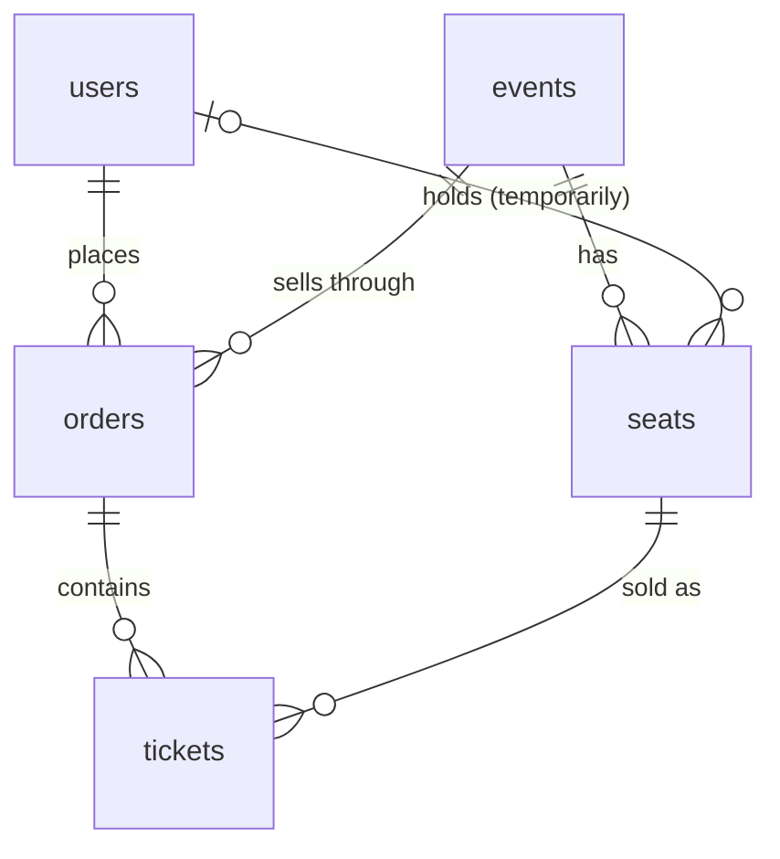
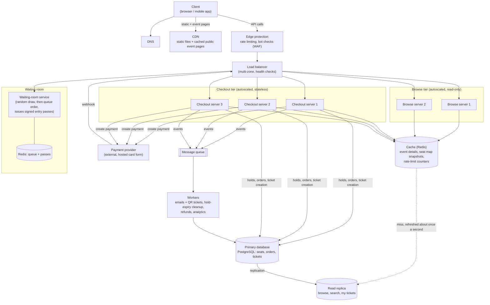

# TicketHub: System Design

TicketHub is a website that sells tickets for concerts and events. Most days it is quiet. A few times a month a very popular concert goes on sale and a huge crowd arrives at the same moment, all wanting the same few seats. The design below is built around that second situation, because it is the one that can break the system and the company's reputation.

**Facts used throughout this document**

- 2 million registered users.
- Normal day: 50,000 people visit, each viewing 10 pages; 5,000 tickets are sold.
- Big sale: 200,000 people try to buy the 20,000 seats of one concert within the first 10 minutes.

The document follows the six-part framework (requirements, estimates, API, data model, architecture, trade-offs). Double-booking is the hardest problem, so it gets its own section (Part 5) that connects the data model and the architecture.

---

## Part 1. Requirements

### 1.1 Functional requirements

1. **Accounts:** a person can register, sign in and sign out.
2. **Browse events:** anyone can list and search events (by city, date, name) and open an event page with its details and prices.
3. **View seats:** for an event, show a seat map with each seat's price and whether it is available.
4. **Hold seats:** a signed-in user can temporarily hold up to 4 seats for 5 minutes while they pay. Nobody else can buy a held seat.
5. **Pay:** a user pays for the held seats by card through an external payment provider.
6. **Get tickets:** after payment the user receives tickets (with a QR code) by email and can see them under "My tickets".
7. **Release:** a user can cancel a hold, and holds that run out of time free their seats automatically.
8. **Organisers/admins** can create events and their seat layouts and set when sales open.
9. **Waiting room:** for events flagged as high demand, buyers first join an online queue and are let in gradually.

### 1.2 Non-functional requirements

| Quality | Requirement |
|---------|-------------|
| **Correctness (most important)** | A seat is **never sold to two people**. A customer is never charged without getting their tickets, and never gets tickets without paying. Retried requests (double clicks, repeated payment notifications) must not create duplicates. |
| **Fairness** | Everybody who arrives in the first minute of a sale has the same chance (position is random, not decided by who has the fastest connection). One person cannot take a whole concert: a limit of 4 tickets per order and per event per account, one place in the queue per account, bot protection when joining the queue. People are told honestly when an event is sold out instead of waiting for nothing. |
| **Speed** | Browsing: 95% of pages under 300 ms. Seat map: under 500 ms. Holding seats: under 500 ms once admitted. Queue status checks must be cheap enough for 200,000 people refreshing. |
| **Availability** | 99.9% overall (about 8.8 hours of downtime a year); the checkout must stay up during a big sale, because that is when the company earns the most and users notice failures the most. |
| **Scalability** | Handle roughly **600 times** the normal request rate for short bursts (see Part 2) without a manual change. |
| **Durability** | Once a customer has paid, the order and tickets are never lost (replication and backups). |
| **Security and privacy** | HTTPS everywhere, hashed passwords, and **card numbers never touch our servers** (the payment provider's hosted form collects them). Users can only see their own orders and tickets. |
| **Auditability** | Orders, payments and ticket changes are recorded so disputes and refunds can be investigated. |

---

## Part 2. Estimates

### 2.1 Normal day

- Page views: 50,000 visitors x 10 pages = **500,000 page views per day**.
- Average: 500,000 / 86,400 s = **about 6 requests per second**.
- Peak (assume 3 times the average, for evenings): **about 17 requests per second**.
- Tickets sold: 5,000 per day = **0.06 per second** on average, and about 0.2 per second at peak. That is about one ticket every 17 seconds on average.
- Storage: about 5,000 tickets a day is about 1.8 million tickets a year. With roughly 500 events a year of 10,000 seats on average (5 million seat rows), orders and users, the database grows only **a few GB per year** (estimate: seats 5M x 150 B = 0.75 GB, tickets 2M x 200 B = 0.4 GB, orders 1M x 300 B = 0.3 GB, doubled for indexes). Size is not the problem; sudden concurrency is.

### 2.2 The big sale (first 10 minutes)

- People: **200,000** trying to buy **20,000 seats** within 10 minutes (600 seconds). That is **10 people for every seat**, so about 90% will go home without a ticket. Fairness and clear messaging matter as much as speed.
- Requests: assume each person makes about 10 requests in those 10 minutes (open the event, load the seat map, refresh it, try to hold seats, queue checks): 200,000 x 10 = **2,000,000 requests in 600 s**.
- Average: 2,000,000 / 600 = **about 3,300 requests per second**.
- Peak (the first seconds, assume 3 times the average): **about 10,000 requests per second**. People do not arrive evenly: if half arrive in the first 30 seconds, that is over 3,000 new people per second.
- Tickets sold: 20,000 seats in 10 minutes = **33 per second on average**, and if the concert sells out in about 3 minutes, **about 100 per second**.
- Hold attempts (the contested write): say 3 attempts per person = 600,000 attempts in 600 s, about 1,000 per second on average, about 3,000 per second at peak, all fighting over the same 20,000 rows.

### 2.3 Comparison

| | Normal day | Big sale (10 minutes) | Ratio |
|---|-----------|----------------------|-------|
| Requests per second, average | about 6 | about 3,300 | **about 575 times** |
| Requests per second, peak | about 17 | about 10,000 | **about 575 times** |
| Tickets sold per second, average | 0.06 | 33 | **about 575 times** |
| Tickets sold per second, peak | about 0.2 | about 100 | about 500 times |
| Tickets sold in total | 5,000 per day | 20,000 in 10 minutes | **4 times a whole normal day, in 10 minutes** |
| Share of people who succeed | almost everyone | about 10% | |

**Conclusions that drive the design**

1. A design for a normal day (about 17 requests a second) would collapse at 10,000. We cannot simply "buy a bigger server" for something that happens a few times a month, so the system must **absorb the spike cheaply**: cache what is shared, and **limit how many people reach the expensive part (seat holding and payment)** with a waiting room.
2. The browsing part of the spike is almost all reads of identical data (event details, seat map), which caches very well.
3. The write part is small in absolute terms (about 100 sales per second) but **extremely concentrated**: thousands of people wanting the same rows at the same instant. This is a **correctness** problem more than a capacity problem, and it is solved in the database (Part 5).

---

## Part 3. API design

REST over HTTPS and JSON, base URL `https://api.tickethub.example/v1`. Authentication: `Authorization: Bearer <token>`. Money is always stored as integer cents. Errors use one shape: `{"error": {"code": "...", "message": "...", "request_id": "..."}}`.

| # | Method | Path | Purpose | Success |
|---|--------|------|---------|---------|
| 1 | `GET` | `/events?city=&from=&q=&cursor=` | Browse and search events (paginated) | `200` |
| 2 | `GET` | `/events/{eventId}` | Event details and sale status | `200` |
| 3 | `GET` | `/events/{eventId}/seats?section=` | Seat map with status of each seat | `200` |
| 4 | `POST` | `/events/{eventId}/queue` | Join the waiting room (high-demand events) | `202` |
| 5 | `GET` | `/events/{eventId}/queue` | Check position and get an entry pass when admitted | `200` |
| 6 | `POST` | `/holds` | Hold 1 to 4 seats for 5 minutes | `201` |
| 7 | `DELETE` | `/holds/{holdId}` | Release held seats | `204` |
| 8 | `POST` | `/orders` | Turn a hold into an order and start the payment | `201` |
| 9 | `POST` | `/payments/webhook` | Called by the payment provider when a payment succeeds or fails | `200` |
| 10 | `GET` | `/orders/{orderId}` | Check an order's status | `200` |
| 11 | `GET` | `/me/tickets` | View my tickets | `200` |
| 12 | `POST` | `/users` and `POST` `/auth/login` | Register and sign in | `201` / `200` |

### 3.1 View seats: `GET /events/812/seats?section=A`

```json
{
  "event_id": 812,
  "as_of": "2026-11-07T18:00:02Z",
  "seats": [
    { "id": 90001, "section": "A", "row": "1", "number": 1, "price_cents": 12000, "status": "available" },
    { "id": 90002, "section": "A", "row": "1", "number": 2, "price_cents": 12000, "status": "held" },
    { "id": 90003, "section": "A", "row": "1", "number": 3, "price_cents": 12000, "status": "sold" }
  ]
}
```

This list is served from a cache refreshed every second or two, so `as_of` tells the client how fresh it is. It is a **hint, not a promise**: the only thing that guarantees a seat is a successful hold.

### 3.2 Hold seats: `POST /holds`

```http
POST /v1/holds
Authorization: Bearer eyJhbGciOi...
X-Queue-Pass: qp_8f31c0...        (required for waiting-room events)
Content-Type: application/json

{ "event_id": 812, "seat_ids": [90001, 90004] }
```

Response `201 Created`:

```json
{
  "hold_id": "6f1d6a52-0d7b-4c19-9b0e-3f4a2f6f1e11",
  "event_id": 812,
  "seat_ids": [90001, 90004],
  "total_cents": 24000,
  "expires_at": "2026-11-07T18:05:03Z"
}
```

If any requested seat is not free, **nothing** is held (all or nothing) and the answer is `409 Conflict`:

```json
{
  "error": {
    "code": "SEAT_UNAVAILABLE",
    "message": "One or more of the seats you chose were just taken. Please pick other seats.",
    "unavailable_seat_ids": [90004],
    "request_id": "req_41c9a2"
  }
}
```

Other holds errors: `400` (more than 4 seats, bad ids), `401` (not signed in), `403` (waiting-room event and no valid queue pass), `404` (unknown event), `429` (too many requests).

### 3.3 Pay: `POST /orders`

```http
POST /v1/orders
Authorization: Bearer eyJhbGciOi...
Idempotency-Key: 0b0e6c2e-7d1a-4f0e-8a4f-6a6e5f1e7c11
Content-Type: application/json

{ "hold_id": "6f1d6a52-0d7b-4c19-9b0e-3f4a2f6f1e11" }
```

Response `201 Created`:

```json
{
  "order_id": 550231,
  "status": "pending",
  "total_cents": 24000,
  "currency": "USD",
  "payment": { "provider_client_secret": "pi_3Nx..._secret_Qz...", "expires_at": "2026-11-07T18:07:03Z" }
}
```

The browser uses `provider_client_secret` to show the payment provider's own card form, so card details go directly to the provider. When the payment succeeds, the provider calls `POST /payments/webhook`; the server then marks the order `paid` and creates the tickets (Part 5.4). The client polls `GET /orders/550231` until `status` is `paid`. The `Idempotency-Key` makes a double click return the same order instead of creating a second one. Errors: `410 Gone` with code `HOLD_EXPIRED` if the hold ran out, `409` if the hold already has an order, `403` if the hold belongs to someone else.

### 3.4 My tickets: `GET /me/tickets`

```json
{
  "data": [
    {
      "ticket_id": 770120,
      "event": { "id": 812, "name": "Neon Skyline Live", "starts_at": "2026-12-12T19:30:00Z", "venue": "City Arena" },
      "seat": { "section": "A", "row": "1", "number": 1 },
      "qr_code": "TH-812-90001-9F3KQ27X",
      "status": "valid"
    }
  ]
}
```

### 3.5 Status codes used

`200`, `201`, `202` (accepted into the queue), `204`, `400` (invalid input), `401` (not signed in), `403` (not allowed, or not admitted from the queue), `404`, `409` (seat taken, duplicate order), `410` (hold expired), `429` (rate limit, with `Retry-After`), `500`, `503` (overloaded, with `Retry-After`).

---

## Part 4. Data model

PostgreSQL (SQL) is the system of record. A seat sale needs transactions, row locks and constraints that the database itself enforces (Part 5), which a relational database provides directly.

### 4.1 Tables

**`users`**

| Column | Type | Notes |
|--------|------|-------|
| `id` | `BIGINT` | **PK** |
| `email` | `VARCHAR(254)` | unique, not null |
| `password_hash` | `VARCHAR(255)` | not null |
| `name` | `VARCHAR(100)` | |
| `created_at` | `TIMESTAMPTZ` | not null |

**`events`**

| Column | Type | Notes |
|--------|------|-------|
| `id` | `BIGINT` | **PK** |
| `name` | `VARCHAR(200)` | not null |
| `venue` | `VARCHAR(200)` | not null |
| `city` | `VARCHAR(100)` | not null |
| `starts_at` | `TIMESTAMPTZ` | not null |
| `on_sale_at` | `TIMESTAMPTZ` | when tickets become available |
| `high_demand` | `BOOLEAN` | if true, buyers must use the waiting room |
| `max_tickets_per_user` | `INT` | default 4 |
| `status` | `VARCHAR(20)` | `draft`, `on_sale`, `sold_out`, `cancelled`, `finished` |

**`seats`** (one row per physical seat **per event**; this is the contested table)

| Column | Type | Notes |
|--------|------|-------|
| `id` | `BIGINT` | **PK** |
| `event_id` | `BIGINT` | **FK** to `events(id)` |
| `section`, `row_label`, `seat_number` | `VARCHAR`, `VARCHAR`, `INT` | together with `event_id` they are **unique** |
| `price_cents` | `INT` | not null |
| `status` | `VARCHAR(10)` | `available`, `held` or `sold` |
| `held_by` | `BIGINT` | **FK** to `users(id)`, set only while held |
| `hold_id` | `UUID` | groups the seats of one hold |
| `hold_expires_at` | `TIMESTAMPTZ` | set only while held |

**`orders`**

| Column | Type | Notes |
|--------|------|-------|
| `id` | `BIGINT` | **PK** |
| `user_id` | `BIGINT` | **FK** to `users(id)` |
| `event_id` | `BIGINT` | **FK** to `events(id)` |
| `hold_id` | `UUID` | the hold this order was created from, **unique** |
| `status` | `VARCHAR(10)` | `pending`, `paid`, `failed`, `refunded` |
| `total_cents` | `INT` | not null |
| `idempotency_key` | `VARCHAR(64)` | unique together with `user_id`, so a repeated request returns the same order |
| `payment_ref` | `VARCHAR(100)` | the provider's payment id, **unique**, so a repeated webhook cannot be applied twice |
| `created_at`, `paid_at` | `TIMESTAMPTZ` | |

**`tickets`** (one row per seat sold; the final guard against double-booking)

| Column | Type | Notes |
|--------|------|-------|
| `id` | `BIGINT` | **PK** |
| `order_id` | `BIGINT` | **FK** to `orders(id)` |
| `seat_id` | `BIGINT` | **FK** to `seats(id)` |
| `qr_code` | `VARCHAR(40)` | unique |
| `status` | `VARCHAR(10)` | `valid` or `cancelled` |

### 4.2 Relationships



- **One user to many orders** (`orders.user_id`); **one event to many seats** (`seats.event_id`); **one order to many tickets** (`tickets.order_id`).
- **One seat to at most one *valid* ticket.** Over time a seat may have several ticket rows (sold, refunded, sold again), but never two `valid` ones at once. This is enforced by the partial unique index in the SQL below.
- `seats.held_by` links a seat to the user holding it for a few minutes.
- Users and events are linked to tickets indirectly through orders and seats, which avoids repeating the same data in several places.

### 4.3 SQL

```sql
CREATE TABLE users (
    id            BIGINT GENERATED ALWAYS AS IDENTITY PRIMARY KEY,
    email         VARCHAR(254) NOT NULL UNIQUE,
    password_hash VARCHAR(255) NOT NULL,
    name          VARCHAR(100),
    created_at    TIMESTAMPTZ NOT NULL DEFAULT now()
);

CREATE TABLE events (
    id                   BIGINT GENERATED ALWAYS AS IDENTITY PRIMARY KEY,
    name                 VARCHAR(200) NOT NULL,
    venue                VARCHAR(200) NOT NULL,
    city                 VARCHAR(100) NOT NULL,
    starts_at            TIMESTAMPTZ NOT NULL,
    on_sale_at           TIMESTAMPTZ,
    high_demand          BOOLEAN NOT NULL DEFAULT false,
    max_tickets_per_user INT NOT NULL DEFAULT 4,
    status               VARCHAR(20) NOT NULL DEFAULT 'draft'
        CHECK (status IN ('draft', 'on_sale', 'sold_out', 'cancelled', 'finished'))
);

CREATE TABLE seats (
    id              BIGINT GENERATED ALWAYS AS IDENTITY PRIMARY KEY,
    event_id        BIGINT NOT NULL REFERENCES events (id),
    section         VARCHAR(20) NOT NULL,
    row_label       VARCHAR(10) NOT NULL,
    seat_number     INT NOT NULL,
    price_cents     INT NOT NULL CHECK (price_cents >= 0),
    status          VARCHAR(10) NOT NULL DEFAULT 'available'
        CHECK (status IN ('available', 'held', 'sold')),
    held_by         BIGINT REFERENCES users (id),
    hold_id         UUID,
    hold_expires_at TIMESTAMPTZ,
    UNIQUE (event_id, section, row_label, seat_number),
    -- a held seat must say who holds it and until when; other seats must not
    CHECK ((status = 'held' AND held_by IS NOT NULL AND hold_id IS NOT NULL AND hold_expires_at IS NOT NULL)
        OR (status <> 'held' AND hold_expires_at IS NULL))
);

CREATE TABLE orders (
    id              BIGINT GENERATED ALWAYS AS IDENTITY PRIMARY KEY,
    user_id         BIGINT NOT NULL REFERENCES users (id),
    event_id        BIGINT NOT NULL REFERENCES events (id),
    hold_id         UUID NOT NULL UNIQUE,
    status          VARCHAR(10) NOT NULL DEFAULT 'pending'
        CHECK (status IN ('pending', 'paid', 'failed', 'refunded')),
    total_cents     INT NOT NULL CHECK (total_cents >= 0),
    idempotency_key VARCHAR(64) NOT NULL,
    payment_ref     VARCHAR(100) UNIQUE,
    created_at      TIMESTAMPTZ NOT NULL DEFAULT now(),
    paid_at         TIMESTAMPTZ,
    UNIQUE (user_id, idempotency_key)
);

CREATE TABLE tickets (
    id        BIGINT GENERATED ALWAYS AS IDENTITY PRIMARY KEY,
    order_id  BIGINT NOT NULL REFERENCES orders (id),
    seat_id   BIGINT NOT NULL REFERENCES seats (id),
    qr_code   VARCHAR(40) NOT NULL UNIQUE,
    status    VARCHAR(10) NOT NULL DEFAULT 'valid' CHECK (status IN ('valid', 'cancelled'))
);

-- The last line of defence: a seat can have at most ONE valid ticket, ever.
CREATE UNIQUE INDEX ux_tickets_one_valid_per_seat ON tickets (seat_id) WHERE status = 'valid';

-- Speed
CREATE INDEX idx_seats_event_status ON seats (event_id, status);          -- seat map, "best available"
CREATE INDEX idx_seats_hold         ON seats (hold_id) WHERE hold_id IS NOT NULL;   -- confirm / release a hold
CREATE INDEX idx_seats_expiry       ON seats (hold_expires_at) WHERE status = 'held'; -- cleanup job
CREATE INDEX idx_orders_user        ON orders (user_id, created_at DESC); -- "my orders"
CREATE INDEX idx_tickets_order      ON tickets (order_id);                -- "my tickets"
```

---

## Part 5. How the design prevents two people buying the same seat

The danger is a **race condition**. If the app first *checks* ("is seat 90001 free? yes") and then *writes* ("mark it mine"), two people can both pass the check before either writes, and both get the seat. At 3,000 attempts per second on the same rows this is not a rare accident, it is certain. The rule of the design: **never check and write in separate steps; let the database decide, atomically, and let constraints make a double sale impossible even if the application code has a bug.**

There are four layers.

### 5.1 Layer 1: an atomic "hold" (transaction plus row locks)

Holding is **one SQL statement** that tests and changes the seat in the same step, inside a transaction:

```sql
BEGIN;

WITH wanted AS (
    SELECT id
    FROM seats
    WHERE event_id = $1
      AND id = ANY($2::bigint[])
      AND (status = 'available' OR (status = 'held' AND hold_expires_at <= now()))
    ORDER BY id
    FOR UPDATE                                  -- lock exactly these rows, in id order
)
UPDATE seats s
SET status = 'held',
    held_by = $3,
    hold_id = $4,
    hold_expires_at = now() + interval '5 minutes'
FROM wanted w
WHERE s.id = w.id
RETURNING s.id;

-- The application compares the number of rows returned with the number of seats requested:
--   equal   -> COMMIT   (all seats are now held by this user)
--   fewer   -> ROLLBACK (nothing is held) and answer 409 SEAT_UNAVAILABLE
```

Why this is safe:

- `FOR UPDATE` puts a **row lock** on each seat. If two people ask for seat 90001 at the same instant, the database lets one go first; the second **waits** until the first transaction commits or rolls back.
- When the second one resumes, PostgreSQL **re-checks the `WHERE` condition against the new, committed row**. The seat is now `held` with a future expiry, so it no longer matches, and the second person gets **zero rows**, which the app turns into `409`.
- The test and the change happen together. There is no gap between "check" and "write" for another request to slip into.
- `ORDER BY id` makes every request lock seats in the same order, so two people who each want seats 1 and 2 cannot deadlock each other.
- **All or nothing:** if one of four seats is gone, the whole transaction rolls back and the user holds nothing, so nobody is left with half a group.
- Expired holds are treated as available **by the query itself** (`hold_expires_at <= now()`), so correctness never depends on a cleanup job running on time. A background worker still resets expired rows to `available` so the seat map looks right.

### 5.2 Layer 2: the hold belongs to one user and has a deadline

The 5-minute hold means a person can pay without the seat being sold from under them, and the deadline stops abandoned baskets from locking seats forever. A `CHECK` constraint guarantees that a `held` seat always records who holds it and until when. The limit of 4 seats per hold (and per account per event) is enforced in the same transaction.

### 5.3 Layer 3: the payment step is idempotent

Payments fail in messy ways: users double-click, networks retry, providers send the same notification twice. Two columns make repeats harmless:

- `orders (user_id, idempotency_key)` is unique, so a repeated `POST /orders` returns the same order.
- `orders.payment_ref` and `orders.hold_id` are unique, so one payment and one hold can create **at most one order**, and a repeated webhook cannot create a second set of tickets.

### 5.4 Layer 4: confirming the sale, with a database constraint as the final guard

When the provider says the payment succeeded, one transaction finalises everything:

```sql
BEGIN;

-- Lock the seats of this hold; they must still be held by this hold_id.
SELECT id FROM seats
WHERE hold_id = $hold_id AND held_by = $user_id AND status = 'held'
ORDER BY id
FOR UPDATE;
-- If the number of rows is not what the order expects, the seats were lost
-- (see "late payment" below): ROLLBACK, mark the order 'failed' and refund.

UPDATE orders SET status = 'paid', paid_at = now(), payment_ref = $payment_ref
WHERE id = $order_id AND status = 'pending';          -- 0 rows = already processed, do nothing

INSERT INTO tickets (order_id, seat_id, qr_code)
SELECT $order_id, id, $qr_prefix || id::text || '-' || substr(md5(random()::text), 1, 8)
FROM seats WHERE hold_id = $hold_id;

UPDATE seats SET status = 'sold', hold_expires_at = NULL WHERE hold_id = $hold_id;

COMMIT;
```

This is **one transaction**: the order, the tickets and the seat status change together or not at all, so there is never a paid order without tickets or tickets without payment. And even if a bug in the application ever tried to sell the same seat twice, the partial unique index `ux_tickets_one_valid_per_seat` makes the second `INSERT` **fail with an error**. The database refuses to store a second valid ticket for one seat, so double-booking is **impossible by construction**, not just unlikely.

**Late payment edge case.** If the hold expires while the user is still typing card details, the order is given a short grace period (the hold is extended by 2 minutes when the order starts). If payment still arrives after the seat was given to someone else, the `hold_id` on that seat no longer matches, the lock query returns too few rows, the transaction rolls back and the customer is refunded automatically. They are told, rather than charged for a seat they do not have.

### 5.5 Layers outside the database (they reduce load, never decide correctness)

- The **seat map** shown to users is cached and may be a second out of date. Seeing "available" for a seat that has just gone is harmless, because only the hold decides, and the user gets a clear `409`, with the map refreshed.
- A **"best available" option** (`SELECT ... FOR UPDATE SKIP LOCKED LIMIT n`, which skips seats another request has locked) lets the server pick seats instead of everyone clicking the same front-row seat. This sharply reduces fighting over the same rows.
- The **waiting room** (Part 6) keeps the number of simultaneous buyers small enough that these locks are short and rarely contended.

---

## Part 6. Architecture

### 6.1 Diagram



### 6.2 What each component does

| Component | What it does and why it is needed |
|-----------|----------------------------------|
| **Client** | The browser or mobile app. It shows events and the seat map, joins the waiting room and polls for its turn, and shows the payment provider's hosted card form. |
| **DNS** | Translates `tickethub.example` and `api.tickethub.example` into addresses, so servers can change without users noticing. |
| **CDN** | Serves images, scripts, styles and public event pages from locations near the user. During a big sale this absorbs most of the traffic before it reaches our servers, because everyone requests the same pages. |
| **Edge protection (WAF, rate limiting, bot checks)** | Blocks abusive traffic, limits requests per account and per address, and runs a CAPTCHA when joining the queue. It supports fairness by making it hard for bots to take many places. |
| **Load balancer** | Spreads requests over healthy servers and removes failed ones, so no single server is overloaded and none is a single point of failure. |
| **Waiting-room service (with Redis)** | The key defence for the big sale. People who arrive in the first minute get a random place in the line, later arrivals follow in order. It admits them at a steady rate (for example 2,000 people a minute, so that about 5,000 are shopping at any time) and gives each admitted person a signed entry pass (`X-Queue-Pass`). Everyone else waits on a cheap status page that costs almost nothing to serve. When the event sells out, everyone waiting is told immediately. |
| **Browse servers** | Handle read-only requests (event lists, details, seat map). They are separate from checkout, so even if browsing is under heavy load, buying is not starved, and the reverse. |
| **Checkout servers** | Stateless servers that implement holds, orders and the payment webhook. They can be added or removed automatically as load changes. |
| **Cache (Redis)** | Stores event details and a **snapshot of the seat map** that is rebuilt about once a second. Ten thousand people reloading the seat map cost the database about **one query per second** instead of ten thousand. It also holds rate-limit counters. It is never the authority on whether a seat is free. |
| **Primary database (PostgreSQL)** | The single source of truth for seats, orders and tickets. All holds and sales happen here because transactions and row locks make double-booking impossible (Part 5). |
| **Read replica** | A copy of the primary that answers search, browse and "my tickets" queries and feeds the seat-map snapshot, keeping read load off the primary. It can be promoted if the primary fails. |
| **Message queue** | Stores background jobs (send the ticket email, generate QR codes, refund a failed late payment) so the buyer's request finishes fast and no job is lost if a worker is down. |
| **Workers** | Process the queued jobs and a regular cleanup that resets expired holds; they can be scaled separately from the web servers. |
| **Payment provider** | An external service that collects card details on its own hosted form and notifies us by webhook. We never see or store card numbers, which greatly reduces our security obligations. |

### 6.3 How the design survives the big sale

**Before the sale:** the organiser flags the event `high_demand`. The event page and its assets are pre-warmed on the CDN. The checkout tier is scaled up ahead of time (scheduled scaling, not just reacting), and the waiting room is open before the on-sale time so people can join the line instead of hammering the site at exactly 10:00.

**During the first seconds (about 10,000 requests per second):**

1. The CDN answers the event page and static files, so most of those requests never reach us.
2. Joining the queue is a very cheap Redis operation, so the waiting room handles over 3,000 new arrivals per second.
3. Seat-map requests are answered from a cache snapshot, so the database sees about one query per second for them.
4. Only admitted people reach checkout, so the database sees a **controlled** number of hold attempts (roughly 500 per second at most, instead of 3,000), which it handles easily.

**During the sale:**

- Holds and sales are short, indexed single-row transactions. At about 100 sales per second this is comfortably within what one PostgreSQL primary can do, and the work is spread over different seat rows.
- The browse and checkout tiers are separate, so a flood of seat-map refreshes cannot slow the payment step.
- Slow work (emails, QR codes) goes through the queue, off the critical path.
- If the system is overloaded anyway, it **degrades gracefully**: the waiting room slows the admission rate, and `503` with `Retry-After` is returned instead of timing out.

**After the sale:** when the last seat is sold the event is marked `sold_out`, the waiting room tells all remaining people at once, and expired holds return a few seats to sale, which the next admitted people can take.

### 6.4 Avoiding single points of failure

| Part | How a failure is survived |
|------|---------------------------|
| DNS, CDN | Managed global services with many locations. |
| Load balancer | Managed, multi-zone, with health checks. |
| Browse and checkout servers | Several identical stateless servers in at least two availability zones, with autoscaling; losing one only reduces capacity. |
| Waiting room | Redis with a replica and failover; passes are **signed**, so checkout servers can verify them without asking Redis. |
| Cache | Replicated; if it is lost, browse falls back to the replica at lower speed and the waiting room limits the damage. |
| Primary database | Synchronous or near-synchronous replica in another zone with automatic failover, plus point-in-time backups. During failover, holds return `503` with `Retry-After`, never a wrong answer. |
| Queue and workers | Durable, replicated queue and two or more workers; unfinished jobs go back on the queue. |
| Payment provider | The external dependency we cannot duplicate easily; the design tolerates outages by keeping orders `pending`, releasing the hold when it expires, and reconciling payments with the provider's records every few minutes. |

---

## Part 7. Trade-offs

1. **Strict correctness in the database vs. raw speed.** Putting the seat decision in PostgreSQL with row locks is slower per request than a pure in-memory solution such as locking seats in Redis, and all hot-seat writes go through one primary. We chose it because overselling a seat costs far more (angry customers, refunds, lost trust) than a few milliseconds, and because the database can also enforce the final constraint. A Redis-based lock would add a second system that can disagree with the database, which is exactly the situation that creates double sales. The cost is limited write throughput, which the waiting room protects.
2. **Waiting room: protection and fairness vs. friction.** Making 200,000 people queue means most of them wait and 90% still leave without tickets, and some will be annoyed by a queue that feels like a lottery. Without it, the choice would be to let everyone in and either crash, or pay for enough servers and database capacity to survive a peak that happens a few times a month. We accept the friction, and reduce it with honest messages, a random draw in the first minute (so speed of connection does not win) and an immediate "sold out" notice.
3. **Cached seat map: stale data vs. database load.** A seat map up to a second old means some people click a seat that has just gone and receive a `409`. In return, 10,000 requests per second cost the database about one query per second. Since the hold is authoritative, a stale map can never cause a wrong sale, only a retry. A real-time map for everyone would need far more infrastructure for a small gain.
4. **Hold length (5 minutes).** A long hold lets people pay calmly but locks seats away from others and lets an abandoned basket block a sale; a short hold recycles seats quickly but rushes users and can expire during payment. Five minutes, plus a 2 minute extension once payment begins, balances the two, and the length can be changed per event.
5. **Two separate tiers (browse and checkout) vs. one simple application.** Splitting them costs more to run and operate, but it stops browsing traffic from starving purchases, and each tier scales on its own.
6. **Random draw for the first minute vs. first come, first served.** A pure first-come order rewards bots and the fastest connections. A short random draw is fairer but can feel arbitrary. We choose fairness, because a sale is decided in seconds.