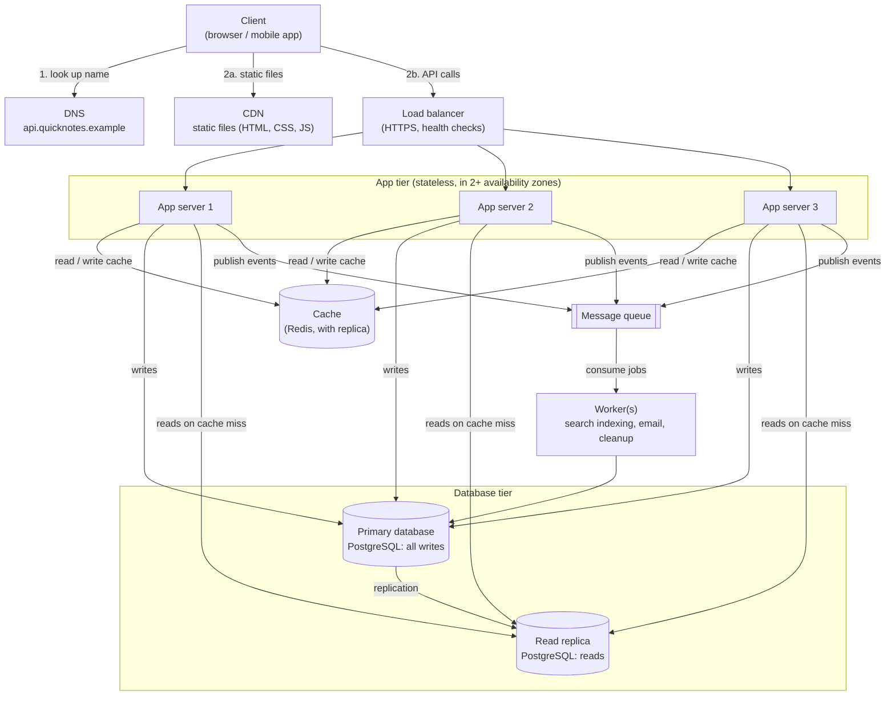

# QuickNotes Architecture

How QuickNotes moves from a browser-only app to an online service that 1 million people can use. This document builds on the API in [`api-design.md`](api-design.md) and the database in [`data-model.md`](data-model.md).

## 1. Requirements

### 1.1 Functional requirements

What the system must do:

1. A person can register, sign in and sign out.
2. A signed-in user can create, view, edit and delete their own notes (title up to 100 characters, optional body).
3. A user can list their notes, newest first, in pages.
4. A user can create tags, attach them to notes and filter notes by tag.
5. A user can only ever see and change their own notes.
6. Notes are searchable by text (delivered by a background job, see the worker below).

### 1.2 Non-functional requirements

How well the system must do it:

| Quality | Target |
|---------|--------|
| **Scale** | 1 million registered users, about 300,000 active per day |
| **Availability** | 99.9% uptime (about 8.8 hours of downtime per year at most); no single component failure may take the service down |
| **Latency** | Listing notes: 95% of requests under 300 ms. Creating a note: 95% under 500 ms |
| **Durability** | A note that was confirmed to the user is never lost (database replication and daily backups) |
| **Consistency** | After creating or editing a note, the author must see it immediately ("read your own writes"). Slight delay for anything else is acceptable |
| **Security** | HTTPS everywhere, hashed passwords, per-user data isolation, rate limiting |
| **Scalability** | Grow by adding servers, not by rewriting; the app tier keeps no local state |
| **Observability** | Central logs, metrics and alerts; every request has a `request_id` |

## 2. Load estimate for 1 million users

**Assumptions** (stated so they can be challenged and re-run):

- 1,000,000 registered users, **30% active per day** = **300,000 daily active users (DAU)**.
- Each active user makes **30 read requests** per day (opening the app, listing, viewing notes).
- Each active user **creates 5 notes** per day.
- Reads are about 6 times more frequent than writes (30 : 5).
- Traffic is not flat: the busiest moment is about **3 times the daily average**.
- One note, including title, body, timestamps and row overhead, takes about **1 KB**.

**Calculation:**

| Quantity | Working | Result |
|----------|---------|--------|
| Reads per day | 300,000 x 30 | 9,000,000 |
| **Reads per second (average)** | 9,000,000 / 86,400 s | **about 104 / s** |
| **Reads per second (peak)** | 104 x 3 | **about 310 / s** |
| Writes per day | 300,000 x 5 | 1,500,000 |
| **Writes per second (average)** | 1,500,000 / 86,400 s | **about 17 / s** |
| **Writes per second (peak)** | 17 x 3 | **about 52 / s** |
| New notes per year | 1,500,000 x 365 | about 548 million |
| **Storage per year** | 548 million x 1 KB | **about 550 GB (0.55 TB)** |
| Storage per year with indexes (about +40%) | 550 GB x 1.4 | about 770 GB, plan for **1 TB per year** |
| Response bandwidth at peak | 310 / s x about 20 KB (a page of 20 notes) | about 6 MB/s (about 50 Mbit/s) |

**What the numbers tell us:**

- About 310 reads per second at peak is small for one modern server, so the multiple app servers are for **redundancy first and capacity second** (3 servers means any one can fail and the other two still carry the peak load).
- With a cache hit rate of about 80%, only about 60 reads per second at peak reach the database, and they go to the read replica.
- 52 writes per second is far below what a single PostgreSQL primary can do (thousands per second), so **sharding is not needed yet**. It is a later step if the product grows 10 to 50 times.
- Storage grows by about 1 TB per year; a single database volume can hold several years of data, but backups and replicas multiply the disk needed, so budget for 3 to 4 times this figure.

## 3. Architecture diagram



The same picture in plain text, for readers that do not render Mermaid:

```text
Client --(1) look up name--> DNS
  |
  +-- static files (HTML, CSS, JS) ------------> CDN
  |
  +-- API calls (HTTPS) --> Load balancer
                                  |
             +--------------------+--------------------+
             |                    |                    |
        App server 1         App server 2         App server 3
             |                    |                    |
             +--------------------+--------------------+
                                  |
              (every app server uses all of the following)
                                  |
        +-------------+-----------+-------------+--------------+
        |             |                         |              |
      Cache      Primary database --------> Read replica     Queue
     (Redis)     (every write)  replication  (cache-miss       |
                       ^                      reads)           v
                       |                                    Worker
                       +--------- worker updates the DB ------+
```

## 4. What each component is for

| Component | The problem it solves |
|-----------|-----------------------|
| **Client** | Gives people an interface (the browser app in this repository, later a mobile app) and talks to the API over HTTPS using the endpoints in `api-design.md`. |
| **DNS** | Turns the human name `api.quicknotes.example` into the address of the load balancer, so servers can be moved or replaced without users changing anything. |
| **CDN** | Serves the static files (HTML, CSS, JavaScript, images) from servers close to the user, so pages load fast and our own servers never carry that traffic. |
| **Load balancer** | Spreads incoming requests across several app servers and stops sending traffic to any server that fails its health check, so no single server is overloaded or a single point of failure. |
| **App servers (2 or more)** | Run the API logic (authentication, validation, business rules); because they keep no session state they can be added, removed or restarted at any time and any of them can answer any request. |
| **Cache (Redis)** | Keeps recently read lists of notes in memory so most reads skip the database, giving answers in about a millisecond and protecting the database from read load. |
| **Primary database** | The single source of truth: it accepts every write and applies the constraints from `data-model.md`, so notes are stored consistently and durably. |
| **Read replica** | A live copy of the primary that answers read queries, which takes load off the primary and can be promoted to primary if the primary dies. |
| **Message queue** | Holds jobs ("note created", "send email") safely until a worker is ready, so slow or unreliable work does not delay the user's request and no job is lost if a worker is down. |
| **Worker** | Processes queued jobs in the background (updating the search index, sending emails, deleting old data), so the API can reply quickly and heavy work can scale separately from the API. |

## 5. Request flows

### 5.1 `GET /notes` (list my notes)

1. The client resolves `api.quicknotes.example` through **DNS** and gets the load balancer's address. (Static files such as `index.html` and `api.js` come from the **CDN**; API responses are marked `Cache-Control: private, no-store` so the CDN never stores one person's notes.)
2. The client sends `GET /v1/notes?limit=20` over HTTPS with its `Authorization: Bearer ...` header.
3. The **load balancer** picks a healthy **app server** (round robin) and forwards the request.
4. The app server validates the token (no database call is needed for a signed token), reads the `user_id` from it and checks the rate limit.
5. It builds a cache key from the user, the page and the user's list version, for example `notes:u123:v7:first`, and asks the **cache**.
6. **Cache hit:** the cached JSON is returned straight to the client (steps 7 to 9 are skipped). This should happen for about 80% of reads.
7. **Cache miss:** the app server runs the paged query from `data-model.md` (query 2, notes with their tags) on the **read replica**. If this user wrote something in the last few seconds, it uses the **primary** instead, so the replica's small replication delay can never hide the user's own newest note.
8. The app server stores the result in the cache with a 60 second time-to-live.
9. It returns `200 OK` with the notes and the `next_cursor` (an empty list is a normal `200`).
10. If the cache is down, the app server skips steps 5 and 8 and reads from the replica: the service gets slower but keeps working.

### 5.2 `POST /notes` (create a note)

1. The client resolves DNS and sends `POST /v1/notes` with a JSON body and its bearer token to the **load balancer**, which forwards it to a healthy **app server**.
2. The app server authenticates the token, applies the rate limit, and **validates the input**: title present and at most 100 characters, body at most 100 KB. Invalid input returns `400` immediately and nothing else is touched.
3. The app server opens a transaction on the **primary database**, inserts the row into `notes` (and `note_tags` rows if tags were given), and, in the same transaction, writes an "event" row ("note 4821 created") to an outbox table. It commits. From this moment the note is durable.
4. The app server bumps the user's list version in the **cache** (`notes:u123:v` goes from 7 to 8), so every cached list page for this user is ignored from now on, and sets a short "recent write" marker so this user's next reads go to the primary.
5. The app server returns `201 Created` with the new note and a `Location` header. The user gets this answer without waiting for step 6.
6. In the background, a small relay publishes the outbox event to the **message queue**. A **worker** picks it up, updates the search index and does any other follow-up work. If the worker fails, the queue keeps the job and retries it; if the queue is briefly down, the outbox row stays in the database and is published later. The note itself is never lost.
7. The primary **replicates** the change to the **read replica** (normally well under a second).

## 6. Trade-offs

1. **Speed vs. freshness (cache and read replica).** Serving reads from a cache and a replica makes the system fast and cheap to scale, but the data can be slightly out of date: a cached page may be up to 60 seconds old and the replica may lag behind the primary. We accept this because notes are rarely edited by two people at once, and we protect the one case that matters, the author seeing their own change, with the version counter and the "recent write" rule from the flows above. The price is extra logic in the app servers.
2. **Fast replies vs. simplicity (queue and worker).** Doing search indexing and emails in a background worker keeps `POST /notes` quick and lets heavy work scale separately, but search results appear a few seconds after the note is saved ("eventual consistency"), there are more moving parts to run and monitor, and jobs can run twice, so workers must be written to be idempotent. A single synchronous call would be simpler but would make every create slower and make the API fail whenever the search index or mail service is down.
3. **One primary database vs. sharding.** A single write primary keeps the data model simple, with real transactions, joins and foreign keys. The limit is that all writes go to one machine. At about 52 writes per second at peak that is not a problem; if traffic grows 10 to 50 times, the plan is to partition by `user_id` (every query already filters by it) rather than redesign the schema now. Sharding today would add cost and complexity for a problem we do not have.
4. **Cost vs. availability.** Three app servers, a cache with a replica, a database replica and a queue cost more than one big server. We pay for it because the availability target (99.9%) cannot be met when any one machine is a single point of failure.
5. **Modular monolith vs. microservices.** The API is one deployable application (with clear internal modules) plus workers, not many small services. This is faster to build and debug for a small team; services can be split out later if one part needs to scale or be owned separately.

## 7. Avoiding single points of failure

A single point of failure (SPOF) is any part whose failure stops the whole service. Each component has a plan:

| Component | How a SPOF is avoided |
|-----------|-----------------------|
| **DNS** | Use a managed DNS provider that runs on many servers worldwide; short time-to-live values allow a quick switch if needed. |
| **CDN** | Provided by a managed network with many edge locations; if an edge fails, requests go to another one. Only static files depend on it. |
| **Load balancer** | Use a managed, multi-zone load balancer (or an active/passive pair with a shared address); health checks remove dead app servers automatically. |
| **App servers** | At least 3 identical, stateless servers spread across 2 or more availability zones (separate data centres); auto-scaling replaces failed ones. Losing one server leaves the other two able to carry the peak load of about 310 requests per second. |
| **Cache** | Redis with a replica and automatic failover. If the cache is lost entirely, the app servers fall back to the database (slower, but still correct), so the cache is an optimisation and not a dependency. |
| **Primary database** | Continuous replication to the **read replica**, placed in another availability zone, with automatic failover that promotes the replica to primary within a minute or so (during that time writes return `503` with `Retry-After`). Plus daily backups and point-in-time recovery for disasters or human error. |
| **Read replica** | At least one replica; if it fails, reads fall back to the primary (which is lightly loaded at about 60 reads per second after caching), and a new replica is built from a backup. |
| **Queue** | A managed, replicated, durable queue; the outbox table in the database means events are not lost even if the queue is unavailable for a while. |
| **Workers** | Two or more workers pulling from the same queue; if one dies, unfinished jobs return to the queue after a timeout and another worker takes them. |

Beyond single components, the team should also keep infrastructure defined as code, deploy with rolling releases so there is no downtime during updates, monitor the health checks, and rehearse a database failover and a backup restore at least once before launch.
