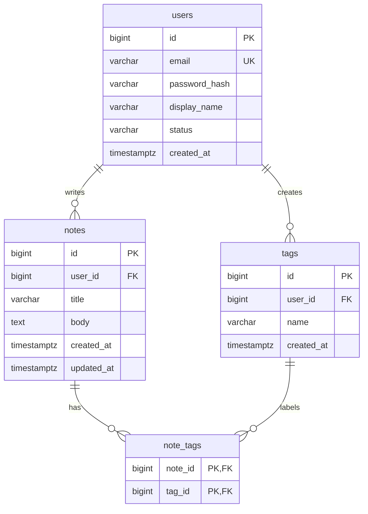

# QuickNotes Data Model

The database design behind the API in [`api-design.md`](api-design.md). SQL below is written for **PostgreSQL**.

## 1. Entities

QuickNotes stores four entities: `users`, `notes`, `tags` and `note_tags`. The last one is a *join table* (also called a link or junction table) that connects notes and tags.

### 1.1 `users`

People who own notes.

| Column | Type | Constraints | Purpose |
|--------|------|-------------|---------|
| `id` | `BIGINT` | **Primary key**, generated automatically | Identifies the user |
| `email` | `VARCHAR(254)` | `NOT NULL`, `UNIQUE` | Login name; unique so two accounts cannot share an email |
| `password_hash` | `VARCHAR(255)` | `NOT NULL` | Salted hash (e.g. bcrypt or argon2). The real password is never stored |
| `display_name` | `VARCHAR(80)` | optional | Name shown in the app |
| `status` | `VARCHAR(20)` | `NOT NULL`, default `'active'`, one of `active`, `suspended`, `unverified` | Drives the `403` rule in the API |
| `created_at` | `TIMESTAMPTZ` | `NOT NULL`, default `now()` | Sign-up time |

### 1.2 `notes`

The core content.

| Column | Type | Constraints | Purpose |
|--------|------|-------------|---------|
| `id` | `BIGINT` | **Primary key**, generated automatically | Identifies the note |
| `user_id` | `BIGINT` | **Foreign key** to `users(id)`, `NOT NULL`, `ON DELETE CASCADE` | The owner |
| `title` | `VARCHAR(100)` | `NOT NULL`, must not be blank | Matches the 100 character rule in the API and the client |
| `body` | `TEXT` | `NOT NULL`, default `''` | The note text (optional for the user, so empty is allowed) |
| `created_at` | `TIMESTAMPTZ` | `NOT NULL`, default `now()` | Creation time, used for sorting |
| `updated_at` | `TIMESTAMPTZ` | `NOT NULL`, default `now()` | Last edit time |

### 1.3 `tags`

Labels a user creates, such as `work` or `errands`. Tags belong to one user, so two users can each have their own `work` tag.

| Column | Type | Constraints | Purpose |
|--------|------|-------------|---------|
| `id` | `BIGINT` | **Primary key**, generated automatically | Identifies the tag |
| `user_id` | `BIGINT` | **Foreign key** to `users(id)`, `NOT NULL`, `ON DELETE CASCADE` | The owner |
| `name` | `VARCHAR(30)` | `NOT NULL`, `UNIQUE` together with `user_id` | Tag text; a user cannot have two tags with the same name |
| `created_at` | `TIMESTAMPTZ` | `NOT NULL`, default `now()` | Creation time |

### 1.4 `note_tags`

One row means "this note has this tag".

| Column | Type | Constraints | Purpose |
|--------|------|-------------|---------|
| `note_id` | `BIGINT` | **Foreign key** to `notes(id)`, `ON DELETE CASCADE` | The note |
| `tag_id` | `BIGINT` | **Foreign key** to `tags(id)`, `ON DELETE CASCADE` | The tag |

The **primary key is the pair (`note_id`, `tag_id`)** (a composite key). That makes it impossible to attach the same tag to the same note twice, which is what makes `PUT /notes/{noteId}/tags/{tagId}` safe to repeat.

## 2. Relationships



**One-to-many (1:N).**

- One **user has many notes**, but each note has exactly one owner. The "many" side (`notes`) holds the foreign key `user_id`.
- One **user has many tags**, but each tag belongs to one user (`tags.user_id`).

**Many-to-many (M:N).** A **note can have many tags** (`Buy milk` is both `errands` and `urgent`), and a **tag can be on many notes** (`errands` is on dozens of notes). A relational database cannot store this with a single foreign key on either side, so the link is stored in the join table `note_tags`: it turns one M:N relationship into two 1:N relationships (`notes` to `note_tags`, and `tags` to `note_tags`).

**Cascading deletes.** Deleting a note automatically deletes its `note_tags` rows, so no dangling links remain. Deleting a user removes their notes and tags too (useful for "delete my account").

**One rule the foreign keys cannot enforce.** A note should only be linked to tags owned by the same user. The API checks this when attaching a tag (otherwise it answers `404`). If the team wants the database to enforce it as well, add `user_id` to `note_tags` and use composite foreign keys.

## 3. CREATE TABLE statements

```sql
CREATE TABLE users (
    id            BIGINT GENERATED ALWAYS AS IDENTITY PRIMARY KEY,
    email         VARCHAR(254) NOT NULL UNIQUE,
    password_hash VARCHAR(255) NOT NULL,
    display_name  VARCHAR(80),
    status        VARCHAR(20)  NOT NULL DEFAULT 'active'
                  CHECK (status IN ('active', 'suspended', 'unverified')),
    created_at    TIMESTAMPTZ  NOT NULL DEFAULT now()
);

CREATE TABLE notes (
    id          BIGINT GENERATED ALWAYS AS IDENTITY PRIMARY KEY,
    user_id     BIGINT       NOT NULL REFERENCES users (id) ON DELETE CASCADE,
    title       VARCHAR(100) NOT NULL CHECK (char_length(btrim(title)) > 0),
    body        TEXT         NOT NULL DEFAULT '',
    created_at  TIMESTAMPTZ  NOT NULL DEFAULT now(),
    updated_at  TIMESTAMPTZ  NOT NULL DEFAULT now()
);

CREATE TABLE tags (
    id          BIGINT GENERATED ALWAYS AS IDENTITY PRIMARY KEY,
    user_id     BIGINT      NOT NULL REFERENCES users (id) ON DELETE CASCADE,
    name        VARCHAR(30) NOT NULL CHECK (char_length(btrim(name)) > 0),
    created_at  TIMESTAMPTZ NOT NULL DEFAULT now(),
    UNIQUE (user_id, name)
);

CREATE TABLE note_tags (
    note_id BIGINT NOT NULL REFERENCES notes (id) ON DELETE CASCADE,
    tag_id  BIGINT NOT NULL REFERENCES tags  (id) ON DELETE CASCADE,
    PRIMARY KEY (note_id, tag_id)
);

-- Indexes (explained in section 5)
CREATE INDEX idx_notes_user_created ON notes (user_id, created_at DESC, id DESC);
CREATE INDEX idx_note_tags_tag_note ON note_tags (tag_id, note_id);
```

## 4. Example queries

`$1`, `$2` and so on are parameters filled in by the application (never build SQL by pasting user text into the string, which would allow SQL injection).

**Query 1: first page of a user's notes (`GET /notes`), newest first.**

```sql
SELECT id, title, body, created_at, updated_at
FROM notes
WHERE user_id = $1
ORDER BY created_at DESC, id DESC
LIMIT 20;
```

For the next page, the cursor carries the last row's `created_at` and `id`, and the query adds a filter instead of using `OFFSET`:

```sql
SELECT id, title, body, created_at, updated_at
FROM notes
WHERE user_id = $1
  AND (created_at, id) < ($2, $3)
ORDER BY created_at DESC, id DESC
LIMIT 20;
```

**Query 2 (JOIN): notes together with their tag names.**

```sql
SELECT n.id,
       n.title,
       n.created_at,
       COALESCE(array_agg(t.name ORDER BY t.name) FILTER (WHERE t.id IS NOT NULL), '{}') AS tags
FROM notes n
LEFT JOIN note_tags nt ON nt.note_id = n.id
LEFT JOIN tags t       ON t.id = nt.tag_id
WHERE n.user_id = $1
GROUP BY n.id
ORDER BY n.created_at DESC, n.id DESC
LIMIT 20;
```

`LEFT JOIN` keeps notes that have no tags at all (they get an empty array). An inner `JOIN` would silently drop them.

**Query 3 (JOIN): all notes that have the tag "errands" (`GET /notes?tag=errands`).**

```sql
SELECT n.id, n.title, n.body, n.created_at
FROM notes n
JOIN note_tags nt ON nt.note_id = n.id
JOIN tags t       ON t.id = nt.tag_id
WHERE n.user_id = $1
  AND t.user_id = $1
  AND t.name = 'errands'
ORDER BY n.created_at DESC, n.id DESC
LIMIT 20;
```

**Query 4: how many notes each of my tags has (a "tag cloud").**

```sql
SELECT t.name, COUNT(nt.note_id) AS note_count
FROM tags t
LEFT JOIN note_tags nt ON nt.tag_id = t.id
WHERE t.user_id = $1
GROUP BY t.id, t.name
ORDER BY note_count DESC, t.name;
```

**Query 5: delete one of my notes (`DELETE /notes/{noteId}`).**

```sql
DELETE FROM notes
WHERE id = $1 AND user_id = $2;   -- 0 rows deleted means the API answers 404
```

Putting `user_id` in the `WHERE` clause is how the API guarantees one user can never touch another user's note.

## 5. Indexes and why

| Index | Reason |
|-------|--------|
| `idx_notes_user_created ON notes (user_id, created_at DESC, id DESC)` | The most common request by far is "show this user's newest notes". Without an index the database would scan all of `notes` (about 550 million new rows per year, see `architecture.md`) to find one user's few hundred rows. With this index it jumps straight to the user's rows, already sorted newest first, and reads only the 20 it needs; no separate sort is needed. It also serves the cursor query, because the filter `(created_at, id) < (...)` follows the same column order. |
| `idx_note_tags_tag_note ON note_tags (tag_id, note_id)` | The primary key (`note_id`, `tag_id`) already makes "tags of this note" fast. This second index covers the opposite direction, "notes of this tag", used by `?tag=errands` and by the tag counts. |
| Unique index on `users (email)` (created automatically by `UNIQUE`) | Login looks users up by email on every sign-in, and the index also enforces one account per email. |
| Unique index on `tags (user_id, name)` (created automatically by `UNIQUE`) | Makes "find this user's tag called `work`" fast and prevents duplicate tags. |

Trade-off: every index makes writes a little slower and uses disk. That is acceptable here because QuickNotes reads about six times more than it writes. The team should check real queries with `EXPLAIN ANALYZE` before adding more.

## 6. SQL or NoSQL?

**Decision: SQL (PostgreSQL).** QuickNotes data is naturally relational: users own notes, and notes and tags form a many-to-many relationship that we want to query in both directions ("tags of a note", "notes of a tag") with joins. A relational database enforces that structure for us with foreign keys, unique constraints and cascading deletes, and it gives transactions, so creating a note and attaching its tags either fully succeeds or fully fails. The load is also comfortably within what one PostgreSQL primary handles: roughly 17 writes per second on average and about half a terabyte of new data per year (see `architecture.md`), with reads spread across a read replica and a cache. A document database such as MongoDB would store a note and its tags in one document, which is quick to read, but it would duplicate tag names across millions of notes, make "rename a tag" a huge update, and push integrity checks into application code. If QuickNotes later outgrows one primary, PostgreSQL can be partitioned or sharded by `user_id` (every query already filters by it), and a dedicated search engine can be added next to it for full-text search without replacing it.
